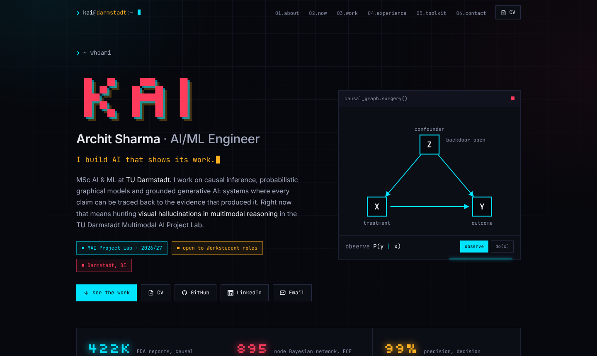

# KAI — Archit Sharma · AI/ML Engineer

> I build AI that shows its work.

Personal portfolio of Archit "Kai" Sharma, MSc AI & ML student at TU Darmstadt, working on causal inference, probabilistic graphical models, grounded generative AI and visual hallucinations in multimodal models.

**Live:** [portfolio-demonkingkais-projects.vercel.app](https://portfolio-demonkingkais-projects.vercel.app) · **GitHub:** [@DEMONKINGKAI](https://github.com/DEMONKINGKAI) · **LinkedIn:** [archit-sharma-work](https://www.linkedin.com/in/archit-sharma-work/)



## What's on the site

- **Hero:** an interactive confounder graph. Hit `do(x)` and the backdoor edge Z → X is cut, turning P(y | x) into P(y | do(x)).
- **Skill graph:** hover a project to light up the tools behind it. It pauses its animation while off screen, and phones get a compact list instead.
- **Currently:** the TU Darmstadt Multimodal AI Project Lab (visual hallucinations in multimodal reasoning traces).
- **Featured work:** [Overseer](https://github.com/DEMONKINGKAI/overseer) and [Decision Graph](https://github.com/DEMONKINGKAI/neuro-graph), with live mini-demos, followed by the causal and grounded-AI projects.
- Experience timeline, toolkit, contact.

The visual style matches the [GitHub profile README](https://github.com/DEMONKINGKAI): void-black base, cyan / crimson / amber accents, pixel type and terminal panels.

## Stack

React 19 · Vite · Tailwind CSS 4 · lucide-react · Vercel (hosting + cookieless Web Analytics)

No external requests at runtime: fonts (Inter, JetBrains Mono, Silkscreen; SIL OFL) are self-hosted from `public/fonts/`.

## Run locally

```bash
npm install
npm run dev       # http://localhost:5173
npm run build     # production build → dist/
npm run lint      # oxlint
```

## Layout

```
src/
  App.jsx                 page assembly, scroll progress + reveal
  components/
    Hero.jsx              KAI glitch title, do(x) panel, stats strip
    SkillGraph.jsx        wraps CausalDAG (desktop) / skill list (mobile)
    CausalDAG.jsx         project ↔ skill graph data + rendering
    About.jsx  Now.jsx  Work.jsx  Experience.jsx  Focus.jsx  Footer.jsx
    SectionEyebrow.jsx    README-style section title bar
    Runner.jsx            running-light border effect
    Cursor.jsx            subtle glow that trails the mouse
  index.css               palette, fonts, shared styles
public/
  Archit_Sharma_CV.pdf    CV (cv.pdf kept for old links)
  og.png                  link-preview image
  datenschutz.html        privacy notice
```

Deployed automatically by Vercel on every push to `main`.
